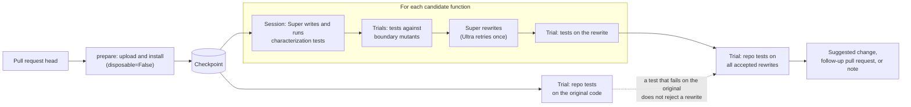

# Slopgate

Slopgate reviews each Python pull request for slop: deep nesting, repeated checks, swallowed errors, one-use wrappers, long if/elif chains, dead code, and new functions that copy an existing helper. It rewrites each finding with NVIDIA Nemotron models on Nebius Token Factory. It keeps a rewrite only if characterization tests of the original code and the repo's own tests pass on it in a Nebius Token Factory Sandbox.

- **Showcase:** https://agno-nymous.github.io/slopgate/ (recorded reviews of 4 pull requests, the benchmark, and how the gate works)
- **Demo repository:** https://github.com/agno-nymous/slopgate-demo (the GitHub Action on real pull requests). Four pull requests add the benchmark's slop to real SWE-bench code, and the Action reviews each one: [flask](https://github.com/agno-nymous/slopgate-demo/pull/5), [pytest](https://github.com/agno-nymous/slopgate-demo/pull/7), [pylint](https://github.com/agno-nymous/slopgate-demo/pull/9), and [seaborn](https://github.com/agno-nymous/slopgate-demo/pull/11).
- **License:** MIT

## Results

The gate benchmark ran on 15 SWE-bench Lite instances from 7 repositories, with 45 injected slop items. The gate used Nemotron 3.5 Super VL (2026-10-30, ticket 77). The hidden SWE-bench tests of each instance judge each accepted rewrite. The gate never sees the hidden tests.

- Slopgate flags 91% of injected slop on real SWE-bench repos (41 of 45 items).
- 49% of the flagged items get a proven one-click fix (20 of 41). 0 of these fixes broke a hidden test.
- The other flagged items get a review note that names the slop and the fix (21 of 41).
- The run costs $0.82 for 15 SWE-bench instances from 7 repositories.

Some kinds are hard to prove. `redundant_check` has 0 of 9 items accepted, and `wrapper` has 3 of 7. `dead` has 5 of 6 items accepted, and `duplicate` has 3 of its 4 detected items accepted. The full table is in [`bench/results/swebench/swebench.md`](bench/results/swebench/swebench.md). Ticket 10 explains the method. The same items with Nemotron 3 Super (2026-10-25) gave 14 of 41 proven fixes for $1.16 ([`swebench-super-3.md`](bench/results/swebench/swebench-super-3.md)).

Slopgate adds a proof, so the fixes it posts broke 0 hidden tests. This benchmark measures whether the gate removes slop and keeps the behavior. It does not measure whether a model fixes an issue, as SWE-bench does.

## How Slopgate uses Nebius and NVIDIA

Each review calls the Token Factory inference API and runs every test in a Token Factory Sandbox (ConTree).

| Job | Model | Why this model |
|---|---|---|
| Find the slop kinds | none | Ruff, vulture, and AST checks find all kinds except `duplicate`. A static check costs nothing and gives the same answer every time. |
| Decide if a new function copies an existing one (`duplicate`) | Nemotron 3.5 Super VL | A forced tool call with a pydantic schema gives a reason and a verdict. A keyword search picks the candidates first, so most functions get no model call. |
| Write the characterization tests (an agent with one `execute` tool in a sandbox session) | Nemotron 3.5 Super VL | Nemotron 3 Super proved 22 of 24 runs on 8 functions. Ultra proved 4 of 24: it probed with `python -c` until the step limit and wrote no test file. |
| Rewrite the function | Nemotron 3.5 Super VL | Ultra costs 3.3 times as much per output token. Super writes the first rewrite of each candidate. |
| Retry a rewrite that failed the proof | Nemotron 3 Ultra | The retry happens at most once per candidate and gets the failure output, so the larger model costs little here. This is a design choice. We did not measure Super against Ultra for the retry. |
| Write the pull request summary | Nemotron 3 Ultra | One short call for each review. |
| Ask the write-time hook "is this a copy?" | Nemotron 3.5 Lightning | One token with logprobs gives a confidence. A hook run with one candidate took 1,652 ms (median of 5), and Lightning costs $0.06 per 1M input tokens. |

All requests send `enable_thinking: False`. With thinking on, a long request can spend the whole output limit on reasoning and return an empty or cut-off reply.

### The sandbox: one checkpoint, many trials

The gate installs the repository once for each review and saves the result as a checkpoint. A trial is one test run that starts from the checkpoint. The sandbox discards the changes of a trial when the trial ends. So trials never affect each other, and the gate runs up to 8 candidates at the same time.



1. `prepare` uploads the head commit and installs it with `disposable=False`. The result is the checkpoint. Then `pytest --collect-only` checks that the tests import.
2. Each trial is `checkpoint.run(...)` with the test files.
3. The test agent gets a session from the checkpoint. The session keeps its files between commands, so the agent can write a test file, run it, and fix it.
4. The gate changes up to 8 comparisons in the function (boundary mutants). If the tests miss a mutant, a second agent round adds tests.
5. The gate accepts a rewrite only if the characterization tests and the repo tests pass on it.

In the first measurement (ticket 02), the install took 6.6 s. Three trials from one checkpoint took 2.4 s in total.

Slopgate does not use Nebius Serverless Jobs. A Serverless Job needs a Nebius AI Cloud tenant, and this project has only Token Factory. The benchmark runs from one command on a laptop.

## Add Slopgate to a repo

1. Add two repository secrets: `NEBIUS_API_KEY` and `NEBIUS_PROJECT_ID` (from https://tokenfactory.nebius.com/project/api-keys).
2. Add this workflow as `.github/workflows/slopgate.yml`:

```yaml
name: Slopgate
on: pull_request
permissions:
  contents: write
  pull-requests: write
jobs:
  slopgate:
    runs-on: ubuntu-latest
    steps:
      - uses: actions/checkout@v4
        with:
          fetch-depth: 0
      - uses: agno-nymous/slopgate@main
        with:
          nebius-api-key: ${{ secrets.NEBIUS_API_KEY }}
          nebius-project-id: ${{ secrets.NEBIUS_PROJECT_ID }}
```

Checkout needs full history (`fetch-depth: 0`), because Slopgate compares the pull request head with its base.

To let Slopgate open follow-up pull requests, turn on **Settings > Actions > General > Workflow permissions > Allow GitHub Actions to create and approve pull requests**. Without it, the review is still posted, and the summary links to the pushed `slopgate/<head branch>` branch instead.

## What a pull request gets

- One review with event `COMMENT`. Each rewrite that edits only lines the pull request added is a suggested change, with its slop kinds, complexity and nesting before and after, and the number of characterization tests that passed.
- One follow-up pull request on branch `slopgate/<head branch>` for every other proven rewrite. It targets the author's branch. Pull requests from forks get no follow-up branch, because the workflow token cannot push to a fork.
- An inline note on each function with slop that Slopgate did not rewrite. The note gives the slop kinds and the fix, and says that Slopgate changed nothing.
- A short summary by Nemotron Ultra with the counts of suggestions, follow-up changes and notes, and the token cost.

Slopgate never fails CI. A pull request without findings gets no comment. If the sandbox cannot install the repo, the pull request gets one notice comment.

### How Slopgate installs your repository

The sandbox is a ConTree Linux container (Debian, root, network access) with Python 3.12, or an older Python for an old commit (rule 3). Slopgate installs pytest, coverage, and uv first. Then it installs your repository. Slopgate uses the first rule that applies:

1. `setup` in `.slopgate.toml`. The sandbox uses Python 3.12 and runs only your `setup`. This override also replaces the old Python and the date pins of the other rules.
2. `uv.lock` with `pyproject.toml`: the locked versions of all dependency groups, then the project itself.
3. `pyproject.toml` or `setup.py`: `pip install -e .`. For a commit from before 2023-10-02, the sandbox installs the dependency versions released before the commit date. It uses the newest Python that was released at least 90 days before the commit (3.6 to 3.11).
4. Only `requirements*.txt`: `pip install -r` for each file.
5. None of these: no install.

If the pinned install of rule 2 or 3 fails, the sandbox falls back to `pip install -e .`. If the repository takes its version from git (setuptools-scm, hatch-vcs), the sandbox has no `.git`, so Slopgate sets the version from the last tag. This export applies to rules 2 and 3. A `setup` override must set `SETUPTOOLS_SCM_PRETEND_VERSION` itself.

After the install, Slopgate runs the `test` command once with `--collect-only` (only when `test` is a pytest command). If no test collects, or the conftest does not import, the gate stops and posts one notice. It writes no test and rewrites nothing. The check passes while at least one test collects. A test module that does not import (for example, a missing optional test dependency) does not stop the gate.

If this install fails, put the install in `.slopgate.toml`. The `setup` text is one shell script. Join commands with `&&`: the sandbox reads only the exit code of the last command, so it can miss an earlier failure. Slopgate then runs `python -m pytest -q -rfE`, or your `test` command:

```toml
[sandbox]
setup = "pip install -e '.[test]'"
test = "python -m pytest -q tests/unit"
```

Two examples of `setup`:

- Test extras: `pip install -e '.[test]'`
- System libraries and extras: `apt-get update && apt-get install -y build-essential libfreetype6-dev && pip install -e '.[test]'`

Slopgate runs the `test` command once on the original code. A test that fails there does not reject a rewrite. The `test` command must be one pytest run. Do not chain commands with `&&`: a failure in the first run stops the second run, and Slopgate cannot see that. Do not use `-x`. Keep `f` and `E` in `-r` (pytest 5.4 and later show them by default). If a run cannot be compared, every failing test rejects the rewrite.

GitHub does not start workflows for pull requests that the workflow token opens, so CI does not run on the follow-up pull request until someone pushes to it.

## Review a pull request on your machine

`slopgate review --pr <number>` reviews one pull request from a local clone and posts the review to GitHub. It does not need a workflow run. It fetches the base and head commits of the pull request from `origin`. It does not change your working tree. Log in with `gh auth login` first. Set `NEBIUS_API_KEY` and `NEBIUS_PROJECT_ID` in the environment. Add `--sandbox local` to run the tests on your machine. Add `--dry-run` to print the result and post nothing.

```sh
slopgate review --pr 12
```

## Try Slopgate on your machine

The [showcase site](https://agno-nymous.github.io/slopgate/) shows recorded reviews, and its try-it page asks Nemotron Super for a rewrite and tests of one function, then runs both in your browser (Pyodide) with your own key. The try-it page runs no sandbox, no static checks, and no repo tests. To run Slopgate yourself, you need two Nebius keys, `uv`, and `git`. The keys stay on your machine. A dry run posts nothing to GitHub.

1. Get `NEBIUS_API_KEY` and `NEBIUS_PROJECT_ID` from https://tokenfactory.nebius.com/project/api-keys. Install `uv` from https://docs.astral.sh/uv/.

2. Set the keys in your shell:

   ```sh
   export NEBIUS_API_KEY=...
   export NEBIUS_PROJECT_ID=...
   ```

3. Clone a repository that has a pull request or two commits with Python changes. This example is the demo repository of Slopgate:

   ```sh
   git clone https://github.com/agno-nymous/slopgate-demo
   cd slopgate-demo
   ```

4. Review the changes between a base commit and a head commit. `--base` and `--head` take any git ref:

   ```sh
   uvx --from git+https://github.com/agno-nymous/slopgate slopgate review --repo . --base 0584a3a --head 441d235 --dry-run
   ```

The command prints the review as JSON: `suggestions`, `followup`, `rejected`, and `notes`. The recordings on the showcase page are this output.

A review of this example took 84 s, 210 s, and 248 s in three runs. The 248 s run used `uvx --refresh`, so it includes a new build of Slopgate. It cost $0.019 in Token Factory tokens (the Phoenix trace of the 210 s run). A larger pull request costs more, because each changed function gets a test agent run in a ConTree sandbox.

## Flag copies while Claude Code writes

`slopgate hook` checks each Python file that Claude Code writes or edits. When a new module-level function does the same job as an existing function, the hook adds a note to the agent's context. The note names the existing function, its file, and a confidence. The hook never blocks a write and always exits 0.

1. Install Slopgate with the `hook` extra in the environment where Claude Code runs:

   ```sh
   pip install 'slopgate[hook] @ git+https://github.com/agno-nymous/slopgate'
   ```

2. Index the repo once. The first run on a machine also compiles the embedding model to `~/.cache/slopgate/` (about 30 s). Later hook runs load it in about 0.3 s.

   ```sh
   slopgate index --ref HEAD
   ```

3. Add the hook to `.claude/settings.json` in the repo:

   ```json
   {
     "hooks": {
       "PostToolUse": [
         {
           "matcher": "Write|Edit|MultiEdit",
           "hooks": [{ "type": "command", "command": "slopgate hook", "timeout": 30 }]
         }
       ]
     }
   }
   ```

4. Export `NEBIUS_API_KEY` in the shell that starts Claude Code. The hook asks Nemotron Lightning only when a local search finds a likely copy.

The hook keeps the functions of the working tree in `.slopgate/live.db`. Each write updates the rows of its own file, so the agent's earlier functions are found too. Functions under `tests/` and functions named `test_*` are never checked or matched.

Files that change outside Claude Code, for example after `git pull`, stay out of date until the next write or the next `slopgate index`. To index after every pull, add `.git/hooks/post-merge` and make it executable:

```sh
#!/bin/sh
slopgate index --ref HEAD >/dev/null
```

## Feedback on Token Factory, Sandboxes, and Nemotron

We built Slopgate from 2026-10-02 to 2026-10-29. Each item gives the problem, what we measured, and a suggestion. The ticket number points to the full record in `issues/`.

### Token Factory inference

1. **Thinking is on by default, also for a forced tool call.** With thinking on, 2 of 3 test-file replies spent the full 8,192 output tokens on reasoning and took 20 s to 37 s each (ticket 21). Nemotron 3.5 Lightning answered "Here" as its first token, so a one-token yes/no check did not work (ticket 07). *Suggestion:* document `chat_template_kwargs: {"enable_thinking": false}` on the model pages and in the quickstart, and turn thinking off when `tool_choice` forces a function.
2. **The default output limit is 8,192 tokens, and the docs do not say so.** One long test file passed it, and the reply was cut off (`finish_reason: "length"`). *Suggestion:* show the default `max_tokens` and the maximum for each model in the catalog.
3. **A prompt over the token quota fails with a 429, not with a context-length error.** Super accepted a 100,021-token prompt, and a 200,021-token prompt failed with HTTP 429. Lightning accepted 400,021 tokens (ticket 67). During the benchmark of 2026-10-21, 5 of 42 items failed with `RateLimitError` (ticket 73). *Suggestion:* publish the quotas for each project (tokens per minute, parallel requests), and send `Retry-After` with every 429.
4. **HTTP 529 "System is overloaded" under parallel load.** In 4 parallel reviews, 3 of 13 items stopped with a 529 in the test agent. The same review alone proved all 4 functions in 84 s (ticket 76). The OpenAI client retries only 2 times. *Suggestion:* send `Retry-After` with a 529 too, and document the retry policy that you expect from clients.
5. **Code inside tool-call arguments breaks.** In a run of 54 replies each, code in a markdown block proved 45 functions, and code in a forced tool call proved 41. The tool-call replies had 3 broken files with wrong bracket types (ticket 20). *Suggestion:* add a short "structured output" guide: decisions as a tool call, code as a markdown block.
6. **`response_format` with a JSON schema hides the field descriptions from the model.** The server enforces the shape, but the model does not see the descriptions: 40 of 46 test files came back as an empty string (ticket 20). A forced tool call shows the descriptions through the chat template (ticket 18). *Suggestion:* document which of the two the chat template shows.
7. **An optional "cannot do it" tool next to a text reply.** With the refusal as an optional tool (`tool_choice: "auto"`), the model refused 12 of 12 complex test-file requests with false reasons (ticket 20). *Suggestion:* note this in the tool-calling docs.
8. **A model left the catalog without a replacement.** `Nemotron-3-Nano-Omni` left the pay-per-call catalog on 2026-08-31, before we started. *Suggestion:* announce removals with a date, and give the replacement model.

What worked well: the OpenAI-compatible API needed no new client. The response has `access-control-allow-origin: *`, so the showcase page can call Token Factory from the browser with the visitor's own key. Logprobs on Lightning gave a usable confidence for the hook.

### Token Factory Sandboxes (ConTree)

1. **Sandbox access needs a separate approval, and the error does not say so.** With a valid key, `GET /sandboxes/v1/images` returned `403 {"error": "Insufficient permissions: list"}`. The approval took one day (ticket 02). *Suggestion:* say "Sandboxes access is not enabled for this project" and link the request form.
2. **`run()` discards the result by default (`disposable=True`).** The install ran, and then the image was gone. A later `run` on it raised `DisposableImageRunError`. We found the cause in the SDK source, not in the docs (ticket 02). *Suggestion:* put the checkpoint pattern (install with `disposable=False`, then many runs) in the quickstart.
3. **A `str` value in `files` is a local path, not file content.** File content must be `bytes` (ticket 02). *Suggestion:* accept both and name the arguments `content` and `path`, or raise an error when a `str` is not an existing path.
4. **No list of the preloaded images.** The docs say that 7,000+ SWE-bench images are preloaded, but give no list. The benchmark imports each image with `images.oci` instead (ticket 10). *Suggestion:* add `images.list(prefix=...)` or a published list.
5. **Upload time-outs.** A file upload failed with `ApiTimeoutError(... /sandboxes/v1/files ...)` (tickets 38 and 60). The gate now retries a ConTree time-out, transport error, 429, or 5xx 2 times (ticket 67). *Suggestion:* retry these inside the SDK.
6. **A command at the time limit loses the session.** `OperationTimedOutError` ended the agent's session, and its test file was lost (ticket 41). The gate now wraps each command in `timeout -k 5` inside the sandbox. *Suggestion:* return exit 124 and keep the session, as `timeout` does.

What worked well: the checkpoint-and-trial pattern is fast. The install took 6.6 s, and three trials from one checkpoint took 2.4 s in total. A file that one trial wrote was absent in the other trials. Network access in the sandbox let pip install old dependency versions for old commits.

### Nemotron models

1. **Super is a good agent for this task, and Ultra is not.** As the characterization test agent, Super proved 22 of 24 runs on 8 functions, and Ultra proved 4 of 24. Ultra ran `python -c` probes until the step limit and wrote no test file (ticket 41). *Suggestion:* publish agentic tool-use results for each model size, not only SWE-bench.
2. **A plain tool loop beat a framework.** On 36 functions, a plain loop with one `execute` tool proved 24, and Deep Agents proved 19 (ticket 41). *Suggestion:* a reference agent loop for Nemotron in the docs.

## Trace model requests in Phoenix (development of this repo only)

Tracing sends each model request of the gate, the hook, and the live tests to a local Arize Phoenix. Use tracing only for work on this repo. Other repos do not trace.

1. Start Phoenix. It listens on this machine only.

   ```sh
   PHOENIX_HOST=127.0.0.1 uvx arize-phoenix serve
   ```

   The UI runs at http://127.0.0.1:6006.

2. Run `uv sync`. It installs the trace packages in the `dev` group (the `trace` extra).

3. Turn on tracing in this repo only. Add this line to the `.env` file of this repo:

   ```sh
   PHOENIX_COLLECTOR_ENDPOINT=http://127.0.0.1:6006
   ```

   The gate and the live tests read `.env` with `--env-file .env`.

   For the hook, add the same variable to the `env` block of `.claude/settings.local.json` in this repo. Claude Code gives that block only to sessions in this repo.

   Do not export the variable in a shell profile. Then every repo with the hook would send traces. Only a local endpoint is accepted.

Traces go to these Phoenix projects: `slopgate-gate`, `slopgate-hook`, and `slopgate-tests`. All gate runs of one pull request are one Phoenix session. All hook runs of one Claude Code session are one Phoenix session. In one pytest run, all cases of one test are one Phoenix session.

Example commands:

```sh
uv run --env-file .env slopgate review --repo . --base origin/main --head HEAD --dry-run
uv run --env-file .env pytest -m live -q -k test_super_tests_reply
```

To turn tracing off, remove the `PHOENIX_COLLECTOR_ENDPOINT` line from `.env` and from `.claude/settings.local.json`.

## Detection benchmark (development of this repo only)

The detection benchmark measures how well the gate finds slop kinds (`classify` in `slopgate/kinds.py`) on code from 12 SWE-bench Lite repos. It runs no sandbox and writes no rewrite. It uses 200 clean functions, and copies of other functions with injected slop: code transforms and Nemotron Super injections.

Run it with one command:

```sh
uv run --env-file .env python -m bench.detect
```

The command clones the repos into `~/.cache/slopgate/bench/` and skips each stage that is already done. To run one stage only, add `sample`, `inject`, `run`, or `report`. A person records a decision for each kind that the gate finds on a clean function in `bench/labels.json`. The same file records whether each Nemotron injection contains its kind. The report leaves out the invalid injections.

The results are in [`bench/results/detection.md`](bench/results/detection.md) and [`bench/results/detection.json`](bench/results/detection.json). Ticket 37 explains them.

## Gate benchmark on SWE-bench (development of this repo only)

The gate benchmark runs the whole gate (`slopgate review`) on SWE-bench Lite instances with injected slop. The gate builds its own sandbox with its normal install, as it does for a user. The hidden tests run on the SWE-bench Docker image of each instance in ConTree. The benchmark injects one slop kind into each of up to 3 functions whose body the instance's hidden tests run. It keeps an injection only if a `raise` at the start of the function breaks a hidden test. Then it runs the gate on the injected commit. The hidden tests (the files of the instance's test patch) are deleted from the commit, so the gate never sees them. After the gate, the benchmark runs the hidden tests on each accepted rewrite.

Run it with one command:

```sh
uv run --env-file .env python -m bench.swebench
```

The command skips each stage that is already done. To run one stage only, add `select`, `run`, `report`, or `install`. `select` writes the ground truth (kind, function, file) before the gate runs. It also saves the injected commit of each instance as a git bundle in [`bench/results/swebench/heads/`](bench/results/swebench/heads/). On a machine with no local clones, `run` clones each repo from GitHub and gets the injected commit from its bundle. The hidden tests use ConTree checkpoints of the Nebius project that ran `select`. So a rerun from a fresh clone works only with a key of that project. `run` skips each instance that `runs.json` already holds, so delete that file first: `rm bench/results/swebench/runs.json && uv run --env-file .env python -m bench.swebench run`.

The results are in [`bench/results/swebench/swebench.md`](bench/results/swebench/swebench.md) and [`bench/results/swebench/swebench.json`](bench/results/swebench/swebench.json). They give the detection recall, the complexity change, the acceptance rate, the silent-break rate, and the token cost, for each slop kind and in total. [`bench/results/swebench/image-sandbox/`](bench/results/swebench/image-sandbox/swebench.md) holds an earlier run in which the gate also used the SWE-bench image. Ticket 10 explains them.
